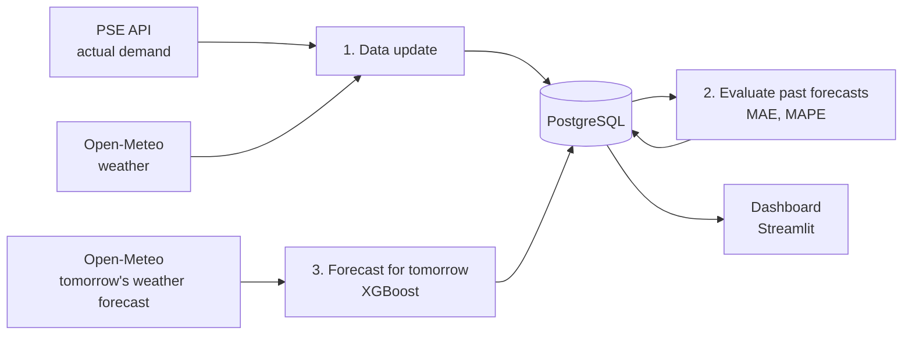

# ⚡ KSE Predictor

An automated MLOps pipeline that forecasts hourly electricity demand in the Polish power grid (KSE) for the next day, every day, and then checks how accurate its own forecasts turned out to be.

**Live dashboard:** http://134.112.24.41:8501


---

## How it works

Every day at 7:41, cron on an Azure VM runs the pipeline in a Docker container:



1. **Data update:** fetches actual demand from the PSE API and weather from Open-Meteo, from the last date in the database up to yesterday, so it automatically catches up after any downtime.
2. **Evaluation:** compares previously stored forecasts with actual demand and stores daily MAE and MAPE.
3. **Forecast:** fetches tomorrow's weather forecast and produces 24 hourly demand forecasts. Each forecast is stored together with its inputs, the time it was made, and the model version.

The dashboard reads the results from the database: tomorrow's forecast, forecasts vs. actual demand, and model error over time.

## Stack

| Area | Technologies |
|---|---|
| Data | PSE API, Open-Meteo, PostgreSQL 18, SQLAlchemy |
| Model | XGBoost, scikit-learn, pandas |
| Infrastructure | Docker, Docker Compose, Azure VM (Ubuntu 24.04), cron |
| Visualization | Streamlit |

## Model

**Features:** temperature, wind speed, solar radiation, day of week, public holidays (`holidays.Poland`), cyclical encoding of hour and month (sin/cos).

**Validation:** time-based split (training → 30-day validation for early stopping → 60-day test), with no random shuffling of hours.

### Results

| Dataset | MAPE | MAE |
|---|---|---|
| Test (last 60 days of history, actual weather) | 2.51% | 446 MW |
| Production (day-ahead forecasts, 21.10–05.11.2026) | 4.82% | — |
| Production, last 7 days | 4.25% | 815 MW |

Part of the gap between test and production comes from the fact that in production the model receives a weather **forecast**, not actual weather. Monitoring also showed that at the end of October the model **systematically underpredicted** demand by about 1 GW: the daily shape was right, but the level was shifted. The next model version will address this with lag features (demand from a week earlier).

## Problems I solved

- **Data leakage from a random split.** A random `train_test_split` on a time series gave inflated results, so I switched to a time-based split.
- **Silent feature mismatch.** A model loaded with a different feature set of the same width ran without errors, but on the wrong inputs. Fixed with an explicit `FEATURES` list, a single `make_features()` function shared by training and inference, and validation of the feature names stored in the model.
- **Daylight saving time change (25.10).** The PSE API marks the repeated hour as `02a`, which broke date parsing and dropped a whole month of data. I added handling for this format, idempotent upserts, and de-duplication by key.
- **Silently swallowed errors.** A data-fetch error was only printed, while the pipeline reported success. Errors are now collected and logged, and the forecast still runs when the PSE API is down.
- **Time zones.** Containers and the server default to UTC, while PSE data is in Polish local time. I set `TZ=Europe/Warsaw` in the image and on the server.

## Project structure

```
├── api/                 # API clients (PSE, Open-Meteo)
├── database/            # config, table models, feature loading, upsert writer
├── training/            # XGBoost training
├── scripts/
│   ├── daily_update.py  # main pipeline (data → evaluation → forecast)
│   ├── backfill.py      # historical data download
│   ├── evaluate.py      # forecast evaluation
│   ├── predict.py       # forecast for tomorrow
│   └── init_db.py       # table creation
├── dashboard/app.py     # Streamlit dashboard
├── notebooks/           # data analysis
├── Dockerfile
└── docker-compose.yaml  # db + app + dashboard
```

## Running

```bash
cp .env.example .env            # fill in database credentials
docker compose up -d db
docker compose run --rm app python scripts/init_db.py
docker compose run --rm app python scripts/backfill.py
docker compose run --rm app python training/xgb_trainer.py
docker compose run --rm app     # single pipeline run
docker compose up -d dashboard  # http://localhost:8501
```

On the server, the pipeline is scheduled with cron:

```
41 7 * * * cd ~/predictor && docker compose run --rm app >> ~/kse_daily.log 2>&1
```

## Data sources

- [PSE reports API](https://api.raporty.pse.pl): actual demand in the Polish power grid
- [Open-Meteo](https://open-meteo.com): historical weather and forecasts
