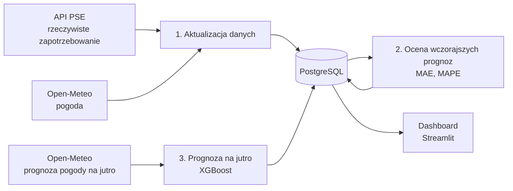

# ⚡ KSE Predictor

Automatyczny pipeline MLOps, który codziennie prognozuje godzinowe zapotrzebowanie na energię elektryczną w Krajowym Systemie Elektroenergetycznym (KSE) na kolejną dobę, a potem sam sprawdza, jak trafne były jego prognozy.

**Dashboard na żywo:** http://134.112.24.41:8501


---

## Jak to działa

Codziennie o 7:41 cron na serwerze w Azure uruchamia pipeline w kontenerze Dockera:



1. **Aktualizacja danych:** pobiera rzeczywiste zapotrzebowanie z API PSE i pogodę z Open-Meteo od ostatniej daty w bazie do wczoraj, więc sam nadrabia zaległości po przerwie.
2. **Ocena:** porównuje zapisane wcześniej prognozy z rzeczywistością i zapisuje dzienne MAE i MAPE.
3. **Prognoza:** pobiera prognozę pogody na jutro i liczy 24 godzinne prognozy zapotrzebowania. Każda prognoza jest zapisywana razem z danymi wejściowymi, datą wykonania i wersją modelu.

Dashboard czyta wyniki z bazy: prognozę na jutro, prognozy na tle rzeczywistości i błąd modelu w czasie.

## Stack

| Obszar | Technologie |
|---|---|
| Dane | API PSE, Open-Meteo, PostgreSQL 18, SQLAlchemy |
| Model | XGBoost, scikit-learn, pandas |
| Infrastruktura | Docker, Docker Compose, Azure VM (Ubuntu 24.04), cron |
| Wizualizacja | Streamlit |

## Model

**Cechy:** temperatura, prędkość wiatru, promieniowanie słoneczne, dzień tygodnia, święta (`holidays.Poland`), cykliczne kodowanie godziny i miesiąca (sin/cos).

**Walidacja:** podział czasowy (trening → 30 dni walidacji do early stopping → 60 dni testu), bez losowego mieszania godzin.

### Wyniki

| Zbiór | MAPE | MAE |
|---|---|---|
| Test (ostatnie 60 dni historii, rzeczywista pogoda) | 2,51% | 446 MW |
| Produkcja (prognozy na kolejną dobę, 21.10–05.11.2026) | 4,82% | — |
| Produkcja, ostatnie 7 dni | 4,25% | 815 MW |

Różnica między testem a produkcją wynika m.in. z tego, że w produkcji model dostaje **prognozę** pogody, a nie pogodę rzeczywistą. Monitoring pokazał też, że pod koniec października model **systematycznie zaniżał** prognozy o ok. 1 GW. Kształt dobowy był trafiony, ale poziom przesunięty. Odpowiedzią na to będą cechy opóźnione (zapotrzebowanie sprzed tygodnia) w kolejnej wersji modelu.

## Problemy, które rozwiązałem

- **Wyciek danych przy losowym podziale.** Losowy `train_test_split` na szeregu czasowym dawał zawyżone wyniki, więc przeszedłem na podział czasowy.
- **Cichy błąd cech.** Model wczytany z innym zestawem cech o tej samej liczbie kolumn liczył się bez błędu, ale na złych danych. Rozwiązanie to jawna lista `FEATURES`, jedna funkcja `make_features()` dla treningu i prognozy oraz walidacja nazw cech zapisanych w modelu.
- **Zmiana czasu (25.10).** API PSE oznacza powtórzoną godzinę jako `02a`, przez co parsowanie dat wywracało zapis całego miesiąca. Dodałem obsługę tego formatu, zapis typu upsert i deduplikację po kluczu.
- **Ciche połykanie błędów.** Błąd pobierania danych był tylko drukowany, a pipeline raportował sukces. Teraz błędy są zbierane i logowane, a prognoza wykonuje się nawet wtedy, gdy API PSE nie odpowiada.
- **Strefy czasowe.** Kontenery i serwer domyślnie działają w UTC, a dane PSE są w czasie polskim. Ustawiłem `TZ=Europe/Warsaw` w obrazie i na serwerze.

## Struktura projektu

```
├── api/                 # klienci API (PSE, Open-Meteo)
├── database/            # konfiguracja, modele tabel, ładowanie cech, zapis (upsert)
├── training/            # trening XGBoost
├── scripts/
│   ├── daily_update.py  # główny pipeline (dane → ocena → prognoza)
│   ├── backfill.py      # pobieranie danych historycznych
│   ├── evaluate.py      # ocena prognoz
│   ├── predict.py       # prognoza na jutro
│   └── init_db.py       # tworzenie tabel
├── dashboard/app.py     # dashboard Streamlit
├── notebooks/           # analiza danych
├── Dockerfile
└── docker-compose.yaml  # db + app + dashboard
```

## Uruchomienie

```bash
cp .env.example .env            # uzupełnij dane bazy
docker compose up -d db
docker compose run --rm app python scripts/init_db.py
docker compose run --rm app python scripts/backfill.py
docker compose run --rm app python training/xgb_trainer.py
docker compose run --rm app     # jedno uruchomienie pipeline'u
docker compose up -d dashboard  # http://localhost:8501
```

Na serwerze pipeline uruchamia cron:

```
41 7 * * * cd ~/predictor && docker compose run --rm app >> ~/kse_daily.log 2>&1
```

## Źródła danych

- [API raportów PSE](https://api.raporty.pse.pl): rzeczywiste zapotrzebowanie KSE
- [Open-Meteo](https://open-meteo.com): pogoda historyczna i prognozy
